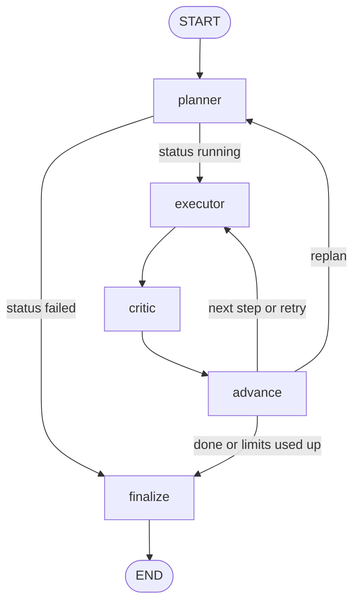

# Multi-Agent Task Orchestrator

A LangGraph system in which three LLM agents complete multi-step tasks on their own, using tools. A **Planner** splits the task into steps, an **Executor** carries out one step at a time (calling tools), and a **Critic** checks each result. Plain Python code, not the LLM, decides where the graph goes next, and every loop has a hard limit.

Built from scratch as a learning project. The system runs on Ollama cloud models (free plan). The numbers below are what was actually measured, including the ones that missed the targets.

## What it does

Give it a task in plain language:

```
python -m src.run "What is 17 * 23? Use the calculator."
```

It will plan the steps, call tools (web search, calculator, file read, file write), check its own work, retry or replan if a step is rejected, and return a final answer. Every run is written to a JSONL trace in `logs/`.

| Agent | Job |
|---|---|
| Planner | Splits the task into 1 to 6 steps. Replans if a step keeps failing. |
| Executor | Does one step. Loops between the LLM and tool calls (at most 5 rounds). |
| Critic | Reads the step's output and the tool log, then says `approve` or `retry`. |

| Tool | Notes |
|---|---|
| `web_search` | `ddgs`; results trimmed to keep the context small |
| `calculator` | Parses with `ast`; never `eval` or `exec` |
| `read_file`, `write_file` | Work only inside `workspace/`; paths that escape it are rejected |

## Architecture



- **The router is code.** The critic gives a verdict; `advance` applies hard limits (`MAX_RETRIES`, `MAX_REPLANS`, `MAX_TOOL_ITERATIONS`, and LangGraph's `recursion_limit`) and picks the next node. No run can loop forever.
- **One gate for every tool call.** The tool must exist, its arguments must pass Pydantic validation, it runs inside `try/except`, and it always returns `{ok, output, error}`. Transient errors (timeouts, rate limits) can be retried with backoff. Tools never raise.
- **Untrusted text is marked as data.** Earlier results, critic feedback and tool output go into prompts inside marked blocks, and the prompts say to treat them as data, not instructions. This lowers prompt-injection risk; it does not remove it.
- **Everything is traced.** Seven event types go to `logs/<run_id>.jsonl`, each line carrying the model name.

The full design is in [`docs/specs/architecture.md`](docs/specs/architecture.md). Design choices and their reasons are in [`docs/plans/decisions.md`](docs/plans/decisions.md).

## Setup

You need Python 3.13 and [Ollama](https://ollama.com) signed in to an Ollama account (the `-cloud` models run on Ollama's servers; on the free plan they have 5-hour and weekly usage caps).

```bash
git clone https://github.com/ms1230895/Multi-agent-task-orchestration-system.git
cd Multi-agent-task-orchestration-system
python3.13 -m venv .venv
source .venv/bin/activate
pip install -r requirements.txt      # exact versions: requirements-lock.txt
cp .env.example .env                 # then check OLLAMA_MODEL in .env
```

The model name is never written in code. It is read from `.env`:

| Variable | Default | Meaning |
|---|---|---|
| `OLLAMA_MODEL` | required | Model for all three agents (tested: `gpt-oss:120b-cloud`) |
| `OLLAMA_MODEL_ALT` | none | Second model for comparisons and the UI selector (tested: `gemma4:31b-cloud`) |
| `ENABLE_VALIDATION`, `ENABLE_RETRY` | `true` | The two reliability features, switched off for the ablation |
| `MAX_RETRIES`, `MAX_REPLANS`, `MAX_TOOL_ITERATIONS`, `TOOL_RETRY_ATTEMPTS` | 2, 1, 5, 2 | Hard limits |
| `UI_ALLOW_LIVE_RUNS` | `false` | `true` lets the web UI start real runs |

## Usage

```bash
python -m src.run "What is 17 * 23? Use the calculator."     # one task, events shown live
python -m streamlit run ui/app.py                            # web UI
python -m benchmark.runner --pass my-pass                    # run or resume a 30-task benchmark pass
python -m benchmark.runner --pass my-pass --summary          # show a pass summary (no LLM calls)
python -m evaluation.report --passes main-off-1,main-on-1    # compare passes (no LLM calls)
python -m evaluation.analyze --pass main-on-1                # group the failures of a pass (no LLM calls)
pytest -q                                                    # tests (no LLM, no internet)
```

### Web UI

`python -m streamlit run ui/app.py` opens three pages:

- **Run a task:** type a task, pick a model, switch validation and retry on or off, and watch a colour-coded timeline fill in live (same colours as the terminal). It appears only when `UI_ALLOW_LIVE_RUNS=true`, because every run uses model quota.
- **Trace explorer:** replay any past run from `logs/` and step through its events.
- **Benchmark dashboard:** success rate per pass with 95% intervals, gate off versus on, and model comparison.

Without `UI_ALLOW_LIVE_RUNS=true` the app is replay-only: the Run page does not exist and nothing can call a model, which makes it safe to host. The UI only displays data; all agent logic stays in `src/`.

## Results

The benchmark has 30 tasks (8 calculator, 7 search, 7 file, 8 multi-tool). Every task has code checkers with fixed expected answers; there is no LLM judge. A task succeeds only if the run finishes and every check passes. Each pass below ran once, so these are single measurements.

| Pass | Model | Validation and retry | Success | 95% interval | Failed tool calls |
|---|---|---|---|---|---|
| `main-off-1` | gpt-oss:120b-cloud | off | 28/30 (93.3%) | 78.7% to 98.2% | 1 of 72 |
| `main-on-1` | gpt-oss:120b-cloud | on | 29/30 (96.7%) | 83.3% to 99.4% | 1 of 71 |
| `second-on-1` | gemma4:31b-cloud | on | 29/30 (96.7%) | 83.3% to 99.4% | 0 of 49 |

**Against the original targets:**

| Target | Result |
|---|---|
| Task success rate around 65% on a self-made 30-task benchmark | **Exceeded: 93% to 97%.** This says the benchmark is easy for these models, not that the system is that good. The three intervals overlap completely. |
| About 20% fewer failed tool calls from validation and retry | **Not measurable.** There was one failed call per pass, so gate off and gate on differ by 0.0 points. The benchmark does not stress the tools enough to show an effect. |
| Reasoning traces from 100+ runs | **Met.** 105 traced runs at evaluation time, 107 now. Traces are in `logs/`, which is not committed. |

**Where it failed.** Four of the 90 task runs across the three passes did not succeed. Three of them shared one cause: the planner splits "read the file" and "pick a line" into two steps, and the critic rejected the second step because it made no tool call, even though it correctly reused the earlier result. Three of the four non-successes held the right answer. A second cause was that the tool log flattened newlines, so the critic could not count lines. Two fixes were made (the critic now sees the approved earlier results, and the log keeps line breaks), but **they were not re-measured**: the post-fix passes were skipped. The analysis is in [`docs/results.md`](docs/results.md) and [`docs/analysis/`](docs/analysis/).

## Honest limitations

- The benchmark is small (30 tasks) and easy, so it cannot separate good configurations. One task is 3.3 percentage points.
- The effect of validation and retry is unmeasured, and so are the two fixes made after the baseline.
- Every pass ran once. There is no run-to-run variance estimate.
- Two models were tried, both on Ollama's free cloud plan.
- Prompt-injection defences lower the risk but are not proven.
- The web UI had a manual check in the browser and 18 unit tests, but no formal code review.
- A run cannot be stopped from the UI; it ends only through the hard limits.
- Screenshots of the UI are not included yet.

## Project layout

```
src/          config, state, tools/, validation, agents/, graph, run, logger, console
benchmark/    tasks.json, checkers, runner (pause and resume, config-mismatch refusal), results/
evaluation/   read-only tools: compare passes, group failures
ui/           Streamlit app (display only)
tests/        888 tests; none call an LLM or the internet
docs/         specs/, plans/, results.md, project-memory.md
logs/         run traces (not committed)
workspace/    sandbox for the file tools
```

## Development

The project was built one layer at a time with a spec, a plan, implementation, tests and review for each step (`docs/specs/`, `docs/plans/`). Hard rules (tools never raise, no `eval`, file tools stay inside `workspace/`, checkers are code, no secrets in the repo) are listed in [`CLAUDE.md`](CLAUDE.md).

```bash
ruff check . --fix && ruff format .
pytest -q
```
