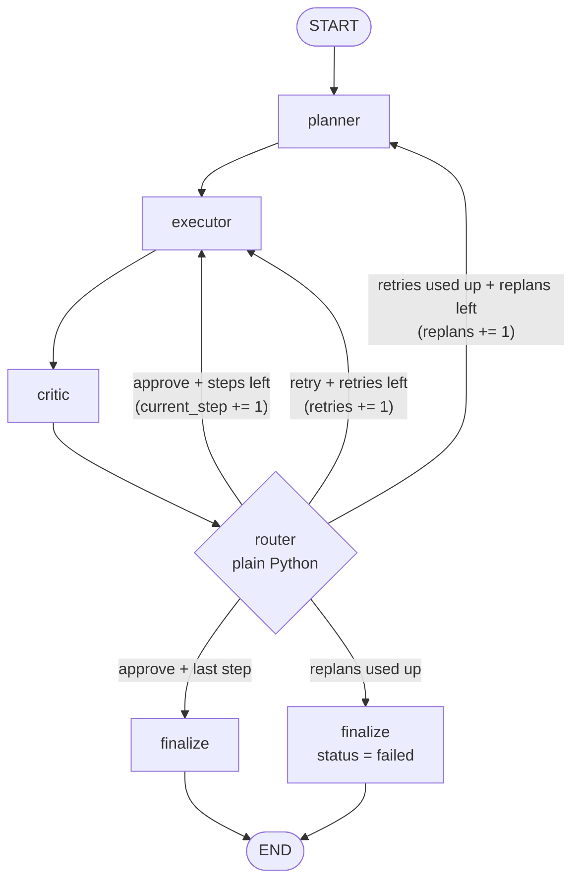

# Architecture

This document describes what we build and how the parts fit together. Read it before changing the structure of the system. Design choices made later go in `docs/plans/decisions.md`; if one of them changes this document, update this document too.

## 1. Overview

A user gives the system a task in plain language. Three LLM agents work on it:

- **Planner** splits the task into a short list of steps.
- **Executor** carries out one step at a time, calling tools when needed.
- **Critic** checks each step's result and says "approve" or "retry".

Plain Python code (the **router**) reads the critic's verdict and decides what happens next. The LLM never decides where the graph goes; code does, with hard limits so no run can loop forever.

## 2. Layers

The system has 7 layers, plus 2 cross-cutting pieces used by every layer. Each layer only depends on the layers below it.

| # | Layer | Lives in | Job |
|---|---|---|---|
| 7 | Benchmark | `benchmark/` | Runs 30 fixed tasks, checks answers with code, reports metrics |
| 6 | Entry point | `src/run.py` | `run_task(task)`: builds the graph, runs it, returns the final state |
| 5 | Orchestration | `src/graph.py`, `src/state.py` | LangGraph graph, `AgentState`, router with hard limits |
| 4 | Agents | `src/agents/` | Planner, Executor, Critic: prompts + output parsing |
| 3 | Reliability | `src/validation.py` | Validation gate + retry around every tool call |
| 2 | Tools | `src/tools/` | web_search, calculator, read_file, write_file + registry |
| 1 | LLM | `src/config.py` (factory) | `ChatOllama` client, model name from `.env` |

Cross-cutting:

- **Config** (`src/config.py`): loads `.env` once, exposes typed settings (model name, flags, limits). Nothing else reads `.env` or environment variables directly.
- **Trace logger** (`src/logger.py`): writes one JSONL file per run in `logs/`. Every layer from 3 up logs events through it.
- **Console** (`src/console.py`): `rich` colour output for humans. Display only; never the source of truth (the trace is).

### 2.1 LLM layer
- One factory function, `get_llm()`, returns a `ChatOllama` built from config: `OLLAMA_MODEL`, `temperature` (default 0 for repeatable runs), and a request timeout.
- Models (free plan, both confirmed to support tool calling):
  - main: `gpt-oss:120b-cloud`
  - second: `gemma4:31b-cloud`
- The model name is never written in code (Hard rule 2). One run and one benchmark pass always use one model.

### 2.2 Tools layer
Four tools. Each one is a plain Python function plus a Pydantic argument schema.

| Tool | Arguments | Behaviour |
|---|---|---|
| `web_search` | `query: str`, `max_results: int = 3` (1–10) | Uses `ddgs`. Returns title, URL, and a snippet per result. Snippets trimmed (about 300 chars each, about 2000 chars total) so the LLM context stays small. |
| `calculator` | `expression: str` | Parses with `ast` and evaluates only allowed nodes: numbers, `+ - * / // % **`, unary minus, parentheses, and a small whitelist of `math` functions. Never `eval`/`exec` (Hard rule 3). Limits on exponent size and expression length. |
| `read_file` | `path: str` | Reads a text file inside `workspace/`. Size cap. |
| `write_file` | `path: str`, `content: str` | Writes a text file inside `workspace/`, creating parent folders. Size cap. |

Path safety for file tools: resolve the path (`Path.resolve()`) and reject it unless it stays inside `workspace/`. This blocks `..`, absolute paths, and symlinks that lead outside (Hard rule 4).

**Return format.** Every tool returns a dict and never raises (Hard rule 1):
```python
{"ok": bool, "output": str | None, "error": str | None}
```

**Registry** (`src/tools/__init__.py`): `TOOLS: dict[str, tuple[type[BaseModel], Callable]]`, mapping a tool name to its schema and function. The same registry gives the LangChain tool definitions that are bound to the executor's LLM (`llm.bind_tools(...)`).

### 2.3 Reliability layer: the validation gate
Every tool call from the executor goes through one function, `call_tool(name, args) -> {ok, output, error}`. The steps run in this order:

1. **Tool exists?** If the name is not in the registry, return `ok=False`, `error="unknown tool: <name>. Available: ..."`.
2. **Arguments valid?** (only when `ENABLE_VALIDATION=true`) Validate `args` against the tool's Pydantic schema. On failure, return `ok=False` with a short readable list of what is wrong (field, problem). Log a `validation_error` event.
3. **Run** the function inside `try/except Exception`. Any exception becomes `ok=False, error="<type>: <message>"`.
4. **Retry** (only when `ENABLE_RETRY=true`): if the failure is *transient* (network error, timeout, rate limit from `ddgs`), wait (backoff 1 s, then 2 s, then 4 s at most) and run again, up to `TOOL_RETRY_ATTEMPTS` extra attempts. Log a `retry` event per attempt. A tool marks a failure as transient by starting its error text with `"transient: "` (`TRANSIENT_PREFIX` in `src/tools/base.py`), which keeps the return format exactly `{ok, output, error}`. In `ddgs` 9.x only timeouts have their own exception; a rate limit arrives as a plain `DDGSException`, so `web_search` also looks for rate-limit and timeout words in the message. Validation errors are never retried by the gate: the same bad arguments would fail again. Instead, the error goes back to the LLM so it can fix them (see Executor).
5. Log a `tool_call` event with name, args, ok, a trimmed output or error, attempts, and duration. `call_tool` does not write the trace itself: it sends events to an optional `on_event(event, data)` callback, and the logger (session 5) is connected there. A callback that raises never changes the tool result.

When `ENABLE_VALIDATION=false`, step 2 is skipped. The raw arguments go straight to the function, and bad arguments fail inside it (caught by step 3). This is the "off" side of the ablation.

### 2.4 Agents layer
Each agent is a function `(state: AgentState) -> dict` that returns only the state fields it changes. Prompts live next to the agent code as constants.

**Planner** (`src/agents/planner.py`)
- Input: `task`. On a replan it also gets the old plan, the step results so far, and the critic's last feedback.
- Output: JSON `{"steps": ["...", "..."]}`, validated by a Pydantic model `Plan` (1 to `MAX_PLAN_STEPS` = 6 steps, each a non-empty string).
- If the JSON is invalid, re-ask once with the validation error. If it is still invalid, set `status="failed"` (the router then finalizes).
- Logs `plan_created` (or `replan` on a replan) with the steps.

**Executor** (`src/agents/executor.py`)
- Works on exactly one step: `plan[current_step]`. It also sees the task and the results of earlier steps, and the critic's feedback if this is a retry.
- Inner tool loop, at most `MAX_TOOL_ITERATIONS` (default 5) rounds:
  1. Call the LLM (with tools bound).
  2. If the reply has no tool calls, that reply is the step's output; stop.
  3. For each tool call: `call_tool(...)`, then append a `ToolMessage` holding the `{ok, output, error}` result. When a call failed, the error text is what lets the LLM correct itself in the next round.
  4. Go to 1.
- If the limit is reached without a final reply, the output is `"Step not completed: tool iteration limit reached"` plus the last tool result. The critic will then reject it.
- Writes `last_output`.

**Critic** (`src/agents/critic.py`)
- Input: task, current step, `last_output`.
- Output: JSON `{"verdict": "approve" | "retry", "feedback": "..."}`, validated by a Pydantic model `Verdict`.
- If the JSON is invalid, re-ask once. If it is still invalid, treat it as `verdict="retry"` with feedback "critic output invalid". This is safe because retries are limited.
- Logs `critic_verdict`.

Planner and Critic always validate their own JSON output, whatever `ENABLE_VALIDATION` says. That flag covers only tool arguments, so the ablation measures one thing.

### 2.5 Orchestration layer

**AgentState** (`src/state.py`), a `TypedDict`:

| Field | Type | Meaning |
|---|---|---|
| `task` | `str` | The user's task, never changed |
| `run_id` | `str` | Unique id, also the trace file name |
| `plan` | `list[str]` | Current plan steps |
| `current_step` | `int` | Index into `plan` (0-based) |
| `step_results` | `list[str]` | Approved output of each finished step |
| `last_output` | `str` | Executor output for the current step, waiting for the critic |
| `verdict` | `str` | `"approve"` or `"retry"` from the critic |
| `feedback` | `str` | Critic's explanation, passed to executor (retry) or planner (replan) |
| `retries` | `int` | Retries used on the **current step** (reset to 0 when a step is approved or a new plan starts) |
| `replans` | `int` | Replans used in the **whole run** (never reset) |
| `final_answer` | `str` | Set by finalize |
| `status` | `str` | `"running"`, `"done"`, or `"failed"` |

**Graph**



(`finalize` and `finalize_failed` are the same node, drawn twice for clarity.)

**Router** (`route_after_critic(state) -> str`), plain Python, no LLM. Rules are checked in this order:

1. `status == "failed"` (e.g. the planner gave up) → `finalize`
2. `verdict == "approve"` and `current_step < len(plan) - 1` → `executor` (next step)
3. `verdict == "approve"` and this is the last step → `finalize` (done)
4. `verdict == "retry"` and `retries < MAX_RETRIES` → `executor` (same step, with feedback)
5. `retries >= MAX_RETRIES` and `replans < MAX_REPLANS` → `planner` (replan)
6. otherwise → `finalize` with `status="failed"`

A conditional edge function in LangGraph should only *choose* the next node. The counter updates (`current_step += 1`, `retries += 1`, `replans += 1`, saving the approved output into `step_results`) happen in a small `advance` node that runs right after the critic. `advance` uses the same rule order, and the router then reads the updated state. This keeps every state change inside a node, where the trace can see it.

On a replan, the new plan starts at `current_step = 0`, `retries = 0`, and `step_results` is cleared. The planner sees the old results in its prompt, so useful work is not lost.

**Finalize** builds `final_answer`: the last approved step result if status is done, or a short failure message with the best partial result if failed. It logs `run_end`.

**Hard limits** (Hard rule 5): `MAX_RETRIES` (default 2), `MAX_REPLANS` (default 1), `MAX_TOOL_ITERATIONS` (default 5), `MAX_PLAN_STEPS` (6), and LangGraph `recursion_limit`. The recursion limit is computed from the other limits, roughly `MAX_PLAN_STEPS × (MAX_RETRIES + 1) × (MAX_REPLANS + 1) × 4 + 10`, so the router's limits always trigger first. If the recursion limit is ever hit, that is a bug.

### 2.6 Entry point
`src/run.py`:
- `run_task(task: str) -> AgentState`: creates `run_id`, opens the trace, builds and invokes the graph with `recursion_limit`, and returns the final state. It never raises: an unexpected exception is caught, logged as `run_end` with `status="failed"` and the error, and returned as a failed state.
- CLI: `python -m src.run "your task here"` prints the plan, steps, verdicts, and final answer with `rich`.

### 2.7 Benchmark
- `benchmark/tasks.json`: 30 tasks. Each has `id`, `category` (calc, search, file, multi-tool), `task`, `checker` (checker name), and `expected` (checker arguments).
- `benchmark/checkers.py`: plain code, never an LLM judge (Hard rule 6). Planned checkers: `number` (with tolerance), `contains` (all / any keywords, case-insensitive), `regex`, `file_content` (a file in `workspace/` holds the expected text). Search tasks use facts that do not change over time, so the checker stays valid.
- `benchmark/runner.py`: runs tasks through `run_task`, applies checkers, saves results (see section 5).
- `workspace/` is reset before each task so tasks cannot affect each other.

## 3. Configuration (`.env` through `src/config.py`)

| Variable | Default | Purpose |
|---|---|---|
| `OLLAMA_MODEL` | (required) | Model name. No default in code. |
| `OLLAMA_TEMPERATURE` | `0` | Repeatability |
| `OLLAMA_TIMEOUT_S` | `120` | Request timeout for one LLM call, so a hung call cannot hang a run |
| `ENABLE_VALIDATION` | `true` | Pydantic gate on tool arguments (ablation flag) |
| `ENABLE_RETRY` | `true` | Gate retries on transient tool errors (ablation flag) |
| `MAX_RETRIES` | `2` | Critic-driven retries per step |
| `MAX_REPLANS` | `1` | Replans per run |
| `MAX_TOOL_ITERATIONS` | `5` | Executor inner loop rounds per step |
| `TOOL_RETRY_ATTEMPTS` | `2` | Extra attempts per transient tool failure |

`config.py` validates these with Pydantic at start-up and stops with a clear message if one is missing or invalid. It never prints the values of secrets (Hard rule 7).

Ablation: the "off" pass sets `ENABLE_VALIDATION=false` and `ENABLE_RETRY=false`. Every other setting (limits, model, temperature) stays identical between the off and on passes, so the only difference measured is the gate.

## 4. Traces

One file per run: `logs/<run_id>.jsonl`, one JSON object per line:
```json
{"ts": "2026-10-16T12:00:00Z", "run_id": "...", "model": "gpt-oss:120b-cloud", "event": "tool_call", "data": {...}}
```
Every line carries `model`, so a trace can never be mixed up between models. The `run_end` event also records the config flags and limits used.

| Event | When | Key `data` fields |
|---|---|---|
| `plan_created` | planner makes the first plan | `steps` |
| `tool_call` | every gated tool call | `tool`, `args`, `ok`, `output`/`error` (trimmed), `attempts`, `duration_ms` |
| `validation_error` | Pydantic rejects tool args | `tool`, `args`, `errors` |
| `retry` | gate retries a transient error, or router sends a step back to the executor | `kind` (`tool` or `step`), `attempt`, `reason` |
| `critic_verdict` | critic returns | `step`, `verdict`, `feedback` |
| `replan` | planner makes a new plan | `replans`, `steps`, `reason` |
| `run_end` | finalize, or a caught crash | `status`, `final_answer`, `counters`, `config`, `error` |

Traces are what we count for "reasoning traces across 100+ runs" and what we read when we debug failures.

## 5. Evaluation design

### Metrics (defined before measuring, so we cannot move the goalposts)
- **Task success rate** = tasks whose checker passes ÷ tasks attempted, per pass.
- **Failed tool call rate** = `tool_call` events with `ok=false` (after all gate retries) ÷ all `tool_call` events, per pass. We report the relative reduction from the off pass to the on pass, and also the absolute numbers.
- **Trace count** = number of `run_end` events in `logs/`.

### Passes, pausing, and resuming
A **pass** is one model + one config running all 30 tasks. The Ollama free plan has 5-hour and weekly usage caps, so a pass may have to stop and continue later.

- Each pass has a folder `benchmark/results/<pass_id>/` containing:
  - `manifest.json`: model, all config flags and limits, git commit, start time. Written once when the pass starts.
  - `results.jsonl`: one line per finished task (`task_id`, `run_id`, `success`, `status`, checker detail, tool-call counts).
- `python -m benchmark.runner --pass <pass_id>` starts a new pass, or resumes one that exists:
  - On resume, the runner compares the current config (model, flags, limits) with the manifest. **If anything differs, it refuses to run.** This is how we never mix models or settings in one pass.
  - Tasks already in `results.jsonl` are skipped.
- **Infrastructure errors are not task failures.** If Ollama returns a usage cap / rate limit / connection error, the runner stops the pass cleanly, does not write a result for that task, and prints "paused, resume later". The task runs again on resume. This keeps a usage cap from looking like an agent failure.
- Planned passes: main model off, main model on, second model on (and second model off if quota allows). Repeated passes are allowed (e.g. `main-on-2`) to reach 100+ runs and to see run-to-run variance.

## 6. Open questions
1. Should the critic be able to request a replan directly (a third verdict, `"replan"`), or should replans only happen after retries are used up? This spec uses only `approve` / `retry`, as listed in the brief.
2. ~~`ENABLE_RETRY` scope~~ Decided in session 2: `ENABLE_RETRY` controls gate-level retries of transient tool errors only (counted by `TOOL_RETRY_ATTEMPTS`). Critic-driven step retries (`MAX_RETRIES`) stay on in both ablation passes. See `docs/plans/decisions.md`.
3. The entry point is a new file, `src/run.py`, which is not yet in the CLAUDE.md layout. Alternative: put `run_task` in `src/graph.py`.
